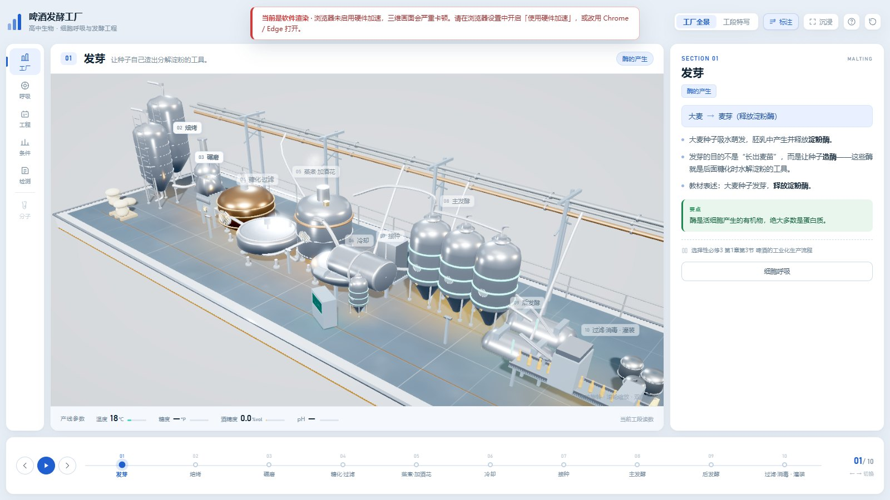
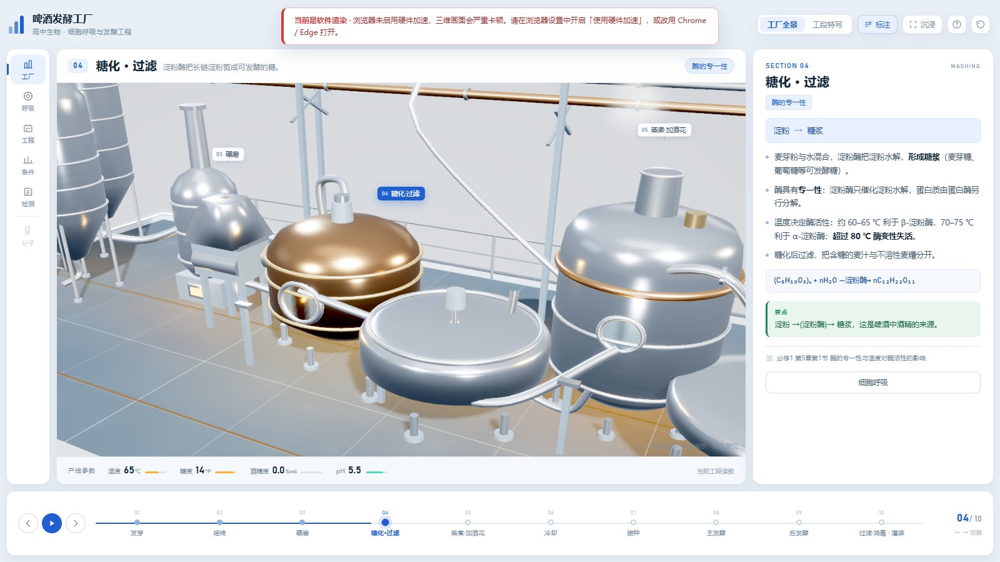
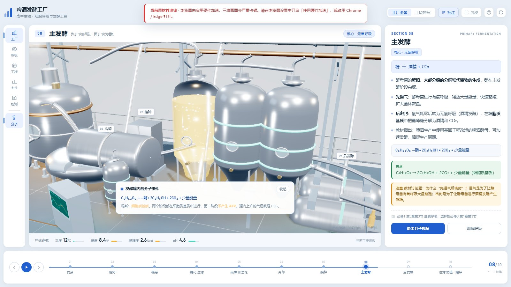

# 啤酒发酵工厂 · 生产流程三维课件

一个可离线双击打开的高中生物课件。整条产线是程序化生成的三维场景（无外部模型依赖），
围绕人教版（2019）**选择性必修3 第1章第3节**「啤酒的工业化生产流程」逐站展开。

界面为**白底 + 深蓝主色**，三维场景是明亮的厂房；文字与三维**分区摆放**，
任何面板都不会压在设备上。琥珀色只留给麦汁与啤酒，是画面里唯一的暖色。



**交付文件：`index.html`（或 `啤酒发酵工厂·生产流程课件.html`）**，单文件约 0.74 MB，three.js 已内联。

---

## 快速开始

双击 HTML 即可。完全离线：无任何外部请求，断网、拷贝到 U 盘都能用。

| 操作 | 说明 |
|---|---|
| 拖动 / 滚轮 | 旋转、缩放三维场景 |
| 点时间轴或画面标注 | 跳到该工段，镜头推近，右侧换成对应的生物学解释 |
| ← → / 1–9 / 空格 | 切换工段 / 直达 / 自动巡演 |
| 左侧五个入口 | 工厂全景、细胞呼吸、发酵工程、条件控制、课堂检测 |
| 第 8 工段「主发酵」 | 可进入发酵罐剖视，看到酵母、气泡与液面 |
| 顶栏「标注」 | 一键隐藏/显示设备标签 |
| 顶栏「沉浸」 | 收起右侧知识栏，三维画面变宽 |

两个开关的状态会记住，下次打开保持。

---

## 十步与教材的对应

教材原图是「发芽 → 焙烤 → 碾磨 → 糖化 → 蒸煮 → 发酵 → 消毒 → 终止」八步，
其中「发酵」又分主发酵与后发酵；流程图另标出加啤酒花、冷却、接种、过滤。
课件把它展开成十站，与教材一一对应：

| 工段 | 教材表述 | 对应生物学知识 |
|---|---|---|
| 01 发芽 | 大麦种子发芽，释放淀粉酶 | 酶的产生 |
| 02 焙烤 | 加热杀死种子胚，但**不使淀粉酶失活** | 酶的特性（易错点） |
| 03 碾磨 | 碾磨成麦芽粉 | 接触面积影响酶促反应速率 |
| 04 糖化·过滤 | 淀粉水解，形成糖浆 | 酶的专一性、温度对酶活性影响 |
| 05 蒸煮·加酒花 | 产生风味组分；终止酶的进一步作用；对糖浆灭菌 | 高温变性；灭菌 vs 消毒 |
| 06 冷却 | 冷却至接种温度 | 温度窗口、避免酵母酶失活 |
| 07 接种 | 接入扩大培养的菌种 | 单一菌种、无菌操作、兼性厌氧 |
| 08 主发酵 | 酵母菌将糖转化为酒精和 CO₂ | 细胞呼吸（核心） |
| 09 后发酵 | 低温密闭储存，澄清成熟 | 低温抑制代谢 |
| 10 过滤·消毒·灌装 | 过滤、调节、分装出售 | 分离提纯；消毒 ≠ 灭菌 |



---

## 准确性说明

- 文案依据人教版（2019）必修1 第5章、选择性必修3 第1章。
- **焙烤**：教材明确为「杀死种子胚但不使淀粉酶失活」，课件按此表述，并单列了常见错误提示。
- **能量数值**：有氧呼吸 2870 kJ、1161 kJ 为教材数值；酒精发酵 225 kJ / 61 kJ 为常用参考值，
  课件中已与乳酸发酵的 196.65 kJ 明确区分。
- **温度**：教材果酒制作的适宜温度是 18–25 ℃；啤酒工业主发酵 8–15 ℃ 是抑制杂菌、减少高级醇的
  **工艺选择**，不是酶的最适温度。课件在对应工段的「注意」里写清了这一点。
- **条件控制模拟**为教学用半定量模型，只呈现趋势（低温变慢、高温变性失活、有氧偏繁殖、无氧偏产酒），
  界面已注明「非工业实测数据」。
- 两道「思考·讨论」按教材原文给出：先通气后密封的原因；密封不严变酸（醋酸菌 → 乙醛 → 醋酸）。



---

## 布局：为什么文字挡不住设备

上一版把知识面板浮在画面上，会盖住最右侧的灌装线，而且面板没有关闭入口。
这一版改成硬分区：

```
[顶栏]
[导航] [ 三维画布 ] [ 知识栏 ]
[ 时间轴 ]
```

三维画布单独占一个网格单元，`renderer` 只在那一格里绘制，知识栏在另一格。
**遮挡不是靠关闭按钮避免的，而是结构上不可能发生**。
工段标题、产线参数、时间轴也都各自占位，只有设备标签浮在场景上，且可一键关闭。

## 性能

场景约 520 个网格 / 7.9 万三角面，真正的开销不在几何，而在「像素」和「合成层」。
这一版做了六件事，**没有降低任何画面效果**：

| 优化 | 做法 | 收益 |
|---|---|---|
| 阴影按需刷新 | 场景基本静态，阴影贴图改为每 12 帧更新一次 | 每帧少渲染一整遍全场深度 |
| 削减冗余光源 | 删掉 2 个强度为 0 的死光源、3 个藏在封闭罐体内完全看不见的点光源 | 15 → 10 盏，所有像素的着色循环变短 |
| 不用实时背景模糊 | `backdrop-filter` 叠在持续动画的画布上时，合成器每帧都要重算；新界面直接用不透明卡片 | 从设计上就不引入 |
| 画布关闭 MSAA | 抗锯齿在 HDR 渲染目标里已经做了，画布本身只画一个全屏四边形 | 省一块多重采样缓冲的带宽 |
| 标注改用 `transform` | 不再每帧写 `left/top` 触发重排，且只在整数像素变化时写样式 | 消除每帧布局抖动 |
| 自适应分辨率 | 只在实测掉到约 46 fps 以下时降 `pixelRatio`，缓升缓降 | 弱机保帧率，强机不降质 |

另外有两档渲染档位：检测到集成显卡 / 软件渲染时自动切「性能档」
（`pixelRatio` 上限 1.0、阴影 1024、泛光两级），独显一律全开。

**诊断开关**

- `?stats=1` —— 页面显示实时帧率 / 渲染倍率 / 绘制调用数。
- `?q=high` / `?q=perf` —— 强制画质档 / 性能档。
- `?post=0` —— 关掉泛光与调色，看场景本身。

> 如果页面提示「当前是软件渲染」，说明浏览器未启用硬件加速，请到浏览器设置里开启，
> 或在 Windows「设置 → 系统 → 显示 → 图形」里把浏览器指定为「高性能」。

---

## 工程结构

```
src/
  00-data.js     知识内容（唯一数据源）
  01-util.js     工具函数 + 渲染档次探测
  10-scene.js    渲染器 / 程序化环境贴图 / 灯光 / 台座
  15-post.js     HDR 合成：亮部提取 → 三级泛光 → ACES → 调色
  20-factory.js  三维厂区（全部程序化建模）
  30-fx.js       蒸汽 / 气泡 / 酵母 / 管道流动 / 输送带
  50-ui.js       时间轴、知识卡、五个弹层、模拟与测验
  style.css      视觉系统
  index.html     页面骨架
  vendor/        three.js r149
build.py         把上面全部内联成两个等价的离线 HTML
dev/             开发期用的截图与性能校验脚本
```

改内容只需改 `src/00-data.js`，时间轴、标注、知识卡、测验会同步更新。
重新打包：`python build.py`。

### 几个实现要点

- 罐体用 `LatheGeometry` 车削成**一张连续曲面**，高光不断裂；发酵罐拆成前后两半，
  剖视时只隐藏前半（含顶部封头），不用裁剪平面。
- 金属要靠环境反射才成立，所以用 PMREM 把一个「渐变穹顶 + 四块柔光板」的小场景烘成 IBL。
  柔光板刻意做**小面积高亮度**：镜面高光强、漫反射弱，地面才不会被打成一片白。
- 粒子用「顶点色 × 寿命」做淡出，配加色混合，省掉逐粒子的 opacity 与自定义 shader。
- 后处理在 HDR 线性空间完成，泛光必须发生在色调映射之前。
- 浅色场景的关键不是"调亮"，而是**拉层次**：环境穹顶做成上亮下暗，金属才有明暗过渡；
  地面压到中灰、背景保持近白，靠明度差把模型从背景里"托"出来。
